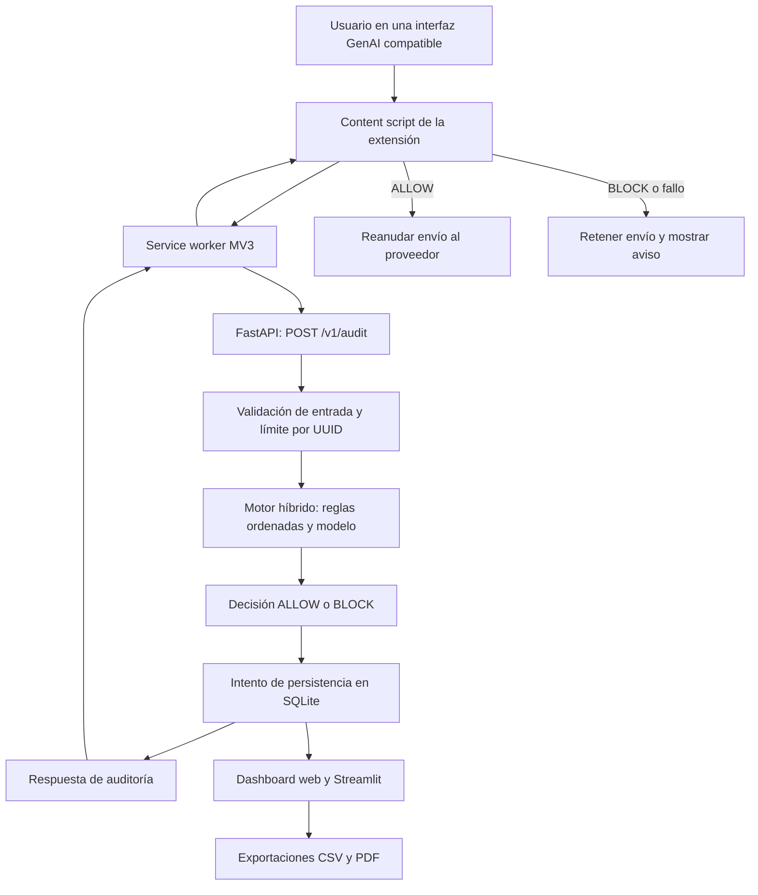

# Aegis DLP: documentación integral del software y base técnica para un artículo científico

**Fecha de revisión:** 19 de septiembre de 2026.  
**Proyecto:** Aegis DLP / Shadow AI DLP Guard / DLP Shadow AI Governance API.  
**Finalidad:** describir el software existente, explicar sus decisiones técnicas y proporcionar evidencia trazable para redactar un artículo original dirigido a una revista indexada en Scopus o SciELO.  
**Fuente principal:** código, configuración, corpus y reportes presentes en este repositorio.

> Este documento es un dossier técnico de investigación, no un manuscrito que ya haya superado revisión por pares. Distingue implementación, resultados experimentales guardados y propuestas de evaluación. Las métricas históricas no se presentan como mediciones nuevas ni como evidencia de eficacia en una empresa real.

## Índice

1. Identidad, propósito y alcance.
2. Problema de investigación y contribución potencial.
3. Arquitectura y recorrido de una solicitud.
4. Taxonomía de riesgo.
5. Motor híbrido y política de decisión.
6. Modelo de lenguaje, entrenamiento y exportación.
7. Construcción, procedencia y calidad del corpus.
8. Extensión de navegador e inspección de adjuntos.
9. API y contratos de datos.
10. Persistencia, privacidad y trazabilidad.
11. Interfaces, visualización y reportes.
12. Despliegue, dependencias y configuración.
13. Inventario del repositorio.
14. Resultados disponibles e interpretación.
15. Pruebas y validación.
16. Limitaciones y amenazas a la validez.
17. Diseño experimental propuesto para el artículo.
18. Estructura y textos iniciales del manuscrito.
19. Reproducción y conservación de evidencia.
20. Referencias y glosario.

## 1. Identidad, propósito y alcance

Aegis DLP es un prototipo de prevención de fuga de datos y aplicación de políticas de uso de inteligencia artificial generativa. Su punto de intervención es el navegador: examina el texto que una persona intenta enviar a determinados asistentes web y decide permitirlo o bloquearlo antes de reanudar el envío controlado por la extensión.

El sistema combina reglas deterministas con un clasificador de texto ejecutado localmente. Las reglas reconocen patrones de datos sensibles y expresiones de intención; el modelo aporta una clasificación estadística para solicitudes no resueltas previamente. El resultado alimenta una bitácora y dos interfaces de supervisión.

El proyecto contiene cinco bloques funcionales: captura e intercepción en Chrome, servicio de auditoría, motor de clasificación, almacenamiento de eventos y visualización. A ellos se añade una cadena de investigación que construye datasets, entrena candidatos, exporta modelos, evalúa resultados y controla su promoción.

La expresión «gobierno de IA» describe aquí un control técnico de entrada y su trazabilidad. El software no implementa por sí solo un sistema completo de gobierno organizacional: no administra todos los modelos de una empresa, no certifica cumplimiento y no sustituye políticas, responsables, evaluación de impacto ni controles de red.

### 1.1 Capacidades implementadas

| Capacidad | Implementación y alcance |
|---|---|
| Auditar prompts | Evaluación local mediante `/v1/audit`; hasta 4096 caracteres por solicitud. |
| Bloquear o permitir | Dos acciones finales: `BLOCK` y `ALLOW`. |
| Clasificar riesgos | Nueve categorías en los esquemas, el motor y la configuración del modelo principal. |
| Detectar datos concretos | Patrones de credenciales, identificadores, información financiera y estructuras tabulares. |
| Detectar intención | Reglas de exfiltración, engaño, evasión y otros dominios restringidos por la política local. |
| Inspeccionar ciertos adjuntos | Archivos de texto compatibles, divididos en segmentos y auditados antes de liberar el evento de carga. |
| Retener envíos ante fallos de comunicación | La extensión conserva el envío pendiente ante errores, tiempo agotado o respuestas inválidas. |
| Registrar eventos | SQLite almacena metadatos, hash y marcador de no retención del contenido. |
| Supervisar actividad | Dashboard web y dashboard Streamlit. |
| Exportar información | CSV y PDF generados por el backend. |
| Entrenar y evaluar | Transformer con LoRA, baseline clásico, métricas, comprobaciones de corpus y aceptación. |
| Probar integración | Pruebas automatizadas del motor, API, corpus y navegador con páginas sintéticas. |

### 1.2 Límites del perímetro

El alcance se limita a los sitios y eventos web que la extensión reconoce. No es un proxy de red, un agente de sistema operativo ni un CASB. No inspecciona aplicaciones nativas, llamadas directas a APIs, navegadores sin la extensión ni todos los mecanismos de envío que un sitio pueda incorporar en el futuro. Tampoco analiza las respuestas generadas por el proveedor ni el historial completo de la conversación.

Una solicitud permitida sigue enviándose al proveedor externo cuando el usuario utiliza su servicio. «Inferencia local» se refiere a la decisión DLP; no significa que el uso posterior del asistente externo sea local.

## 2. Problema de investigación y contribución potencial

El problema abordado es la transferencia de información sensible o la formulación de solicitudes contrarias a políticas organizacionales a través de asistentes generativos. El sistema considera tanto el contenido que ya aparece en el prompt como la intención de obtener, procesar o divulgar información privada.

Esta distinción es relevante: una instrucción puede expresar una transferencia riesgosa aunque no incluya todavía el dato. Sin embargo, el sistema no puede verificar si la persona está autorizada realmente ni acceder por sí mismo a los archivos o conversaciones mencionados. Su decisión depende del texto observado y de la política implementada.

El marco de seguridad de OWASP identifica la divulgación de información sensible como un riesgo de aplicaciones basadas en modelos de lenguaje. Aegis interviene en la entrada del usuario, mientras que la descripción de OWASP también abarca riesgos asociados a las salidas y al diseño de aplicaciones. No son alcances idénticos. Fuente: [OWASP, LLM02:2025 Sensitive Information Disclosure](https://genai.owasp.org/llmrisk/llm022025-sensitive-information-disclosure/).

### 2.1 Objetivo general propuesto

Diseñar y evaluar un mecanismo local de inspección previa de solicitudes a asistentes generativos que combine clasificación de riesgo, reglas organizacionales e intercepción de navegador, midiendo simultáneamente prevención de solicitudes restringidas, interferencia con usos legítimos y costo operativo.

### 2.2 Contribuciones que podrían sustentarse

1. Una arquitectura integrada que relaciona decisión local, control del envío y registro de auditoría.
2. Una política de nueve clases que combina sensibilidad del dato e intención de la solicitud.
3. Una construcción de corpus con procedencia, cuarentena y separación de familias de ejemplos.
4. Una evaluación conjunta de clasificación multiclase y decisión binaria de permitir o bloquear.
5. Un análisis del equilibrio entre reglas conservadoras, falsos bloqueos y latencia.

Estas son contribuciones de diseño e integración que deben contrastarse con trabajos relacionados. El repositorio no acredita que la combinación sea inédita internacionalmente ni que supere soluciones comerciales. La originalidad científica requiere formular y probar una diferencia concreta, no solo enumerar tecnologías utilizadas.

## 3. Arquitectura y recorrido de una solicitud

### 3.1 Componentes



La evaluación de reglas y modelo es secuencial y utiliza retornos anticipados. No hay evidencia de que las heurísticas y el Transformer se ejecuten concurrentemente para decidir una misma solicitud. La paralelización del benchmark HTTP es una característica distinta.

### 3.2 Secuencia operativa

1. El content script reconoce el editor y las acciones de envío de una página compatible.
2. Intercepta Enter, clic o submit según los mecanismos implementados.
3. Obtiene el texto e incorpora el identificador seudónimo del navegador y el destino.
4. Solicita la auditoría al service worker mediante un mensaje `AEGIS_AUDIT`.
5. El worker consulta la API local por HTTP.
6. FastAPI valida longitud, UUID y destino; después aplica el límite de solicitudes.
7. El motor recorre sus excepciones y reglas. Solo llega al modelo si ninguna condición anterior determina una respuesta.
8. La API calcula el hash del texto, produce una vista parcialmente redactada e intenta registrar el evento.
9. Devuelve acción, categoría, riesgo, motivo, versión, duración y reglas coincidentes.
10. La extensión muestra el bloqueo o reanuda el envío autorizado.

**Matiz del registro:** una excepción de persistencia se captura y no impide devolver la decisión. Por tanto, «decisión entregada» y «evento almacenado» no son equivalentes en todos los casos.

## 4. Taxonomía de riesgo

Las clases se encuentran en `api/schemas.py`, `api/engine.py` y `models/dlp_slm/aegis_config.json`.

| ID | Clase | Interpretación prevista | Acción habitual |
|---|---|---|---|
| 0 | `Safe_Use` | Uso permitido: tareas públicas, ficticias o no sensibles y ciertos contextos defensivos. | ALLOW |
| 1 | `PII_Leak` | Exposición o tratamiento indebido de información personal identificable. | BLOCK |
| 2 | `Proprietary_Code` | Credenciales, secretos técnicos y código reservado. | BLOCK |
| 3 | `Business_Secrets` | Información estratégica, comercial o financiera reservada. | BLOCK |
| 4 | `Code_Exploitation` | Explotación, intrusión o dominios técnicos restringidos por la política. | BLOCK |
| 5 | `Data_Exfiltration` | Extracción o transferencia de información privada o restringida. | BLOCK |
| 6 | `Social_Engineering` | Suplantación, phishing y obtención engañosa de acceso o datos. | BLOCK |
| 7 | `Role_Evasion_Jailbreak` | Intentos de eludir políticas o sustituir instrucciones de mayor prioridad. | BLOCK |
| 8 | `Legal_Misalignment` | Falsificación, encubrimiento, discriminación y otras conductas incluidas en la política local. | BLOCK |

La clasificación es de etiqueta única, aunque las categorías se solapan conceptualmente. Una solicitud puede combinar phishing y exfiltración; el sistema devuelve la primera categoría determinada por su orden de reglas o la clase de máxima probabilidad del modelo.

La guía de anotación prioriza la acción solicitada para resolver solapamientos. Sin embargo, algunas reglas heredadas asignan intención de extracción o phishing a `PII_Leak`. El artículo debe distinguir esa implementación de la taxonomía ideal y reportar ambos tipos de error: confusión entre categorías bloqueadas y autorización de contenido que debía bloquearse.

`Legal_Misalignment` es el nombre de una etiqueta computacional; no equivale a una resolución jurídica sobre el caso analizado.

## 5. Motor híbrido y política de decisión

### 5.1 Organización del motor

`DlpEngine`, en `api/engine.py`, utiliza una instancia compartida para cargar el modelo y evaluar solicitudes. Busca artefactos en `models/dlp_slm`. Cuando hay un ONNX compatible, inicializa ONNX Runtime con `CPUExecutionProvider` y un tokenizador local.

Si encuentra `model.int8.onnx`, el cargador lo prioriza; en caso contrario intenta `model.onnx`. Si falla la carga ONNX, puede usar `model.joblib`. Si no dispone de un clasificador utilizable, continúa con las reglas y un fallback final.

En la revisión actual, la carpeta principal contiene `model.onnx` y `pytorch_model.bin`, pero no `model.int8.onnx` ni `model.joblib`. Su configuración declara versión `5.0`, cuantización `fp32` y alcance `local_testing`. Esto describe los artefactos predeterminados; no acredita por sí solo qué proceso está ejecutándose en un puerto del equipo.

### 5.2 Orden efectivo de evaluación

| Orden | Etapa | Comportamiento |
|---|---|---|
| 1 | Excepciones de seguridad reconocidas como seguras | Algunas expresiones precisas de orientación pública o defensiva devuelven ALLOW inmediatamente. |
| 2 | Guardia estricta de intención | Bloquea patrones de evasión, engaño, explotación y otros dominios de la política. |
| 3 | Secretos técnicos | Busca llaves privadas, tokens, credenciales y conexiones. |
| 4 | Reglas adicionales de intención | Evalúa procesamiento privado, divulgación, phishing, evasión y abuso. |
| 5 | Orientación defensiva admitida | Permite ciertas construcciones defensivas si alcanzan esta etapa. |
| 6 | Información empresarial | Combina tablas, términos empresariales, confidencialidad y contexto de adjuntos. |
| 7 | Información personal | Busca identificadores, correos, teléfonos y otros patrones sensibles. |
| 8 | Excepción académica o pública | Permite determinadas tareas sin señales sensibles consideradas por esa condición. |
| 9 | Clasificador estadístico | Devuelve la clase con máxima probabilidad y determina ALLOW/BLOCK. |
| 10 | Fallback sin clasificación | Devuelve ALLOW si ninguna etapa anterior resolvió el caso. |

Este orden es parte del algoritmo, no un detalle de presentación. La primera excepción segura aparece antes de las reglas de credenciales y PII. En consecuencia, debe evaluarse con solicitudes mixtas que combinen lenguaje permitido y datos sensibles; no puede describirse como una arquitectura donde los secretos siempre tienen prioridad.

### 5.3 Normalización y tolerancia a variaciones

`api/strict_intent_guard.py` aplica normalización Unicode NFKD, elimina marcas diacríticas, convierte a minúsculas, transforma sustituciones frecuentes de letras por números y reduce separadores. También utiliza `SequenceMatcher` para aproximar ciertas palabras a anclas de riesgo, con similitud mínima de 0,80 y restricciones de longitud.

Esto permite reconocer algunas faltas ortográficas y formas simples de ofuscación. No demuestra robustez frente a todas las paráfrasis, idiomas, codificaciones o ataques adaptativos.

La política estricta incluye términos amplios como ciberseguridad, DLP, vulnerabilidades e ingeniería inversa. Por ello, un bloqueo puede reflejar una restricción temática organizacional y no la detección de una conducta objetivamente maliciosa. Esta amplitud puede incrementar la retención de solicitudes, pero también los falsos bloqueos.

### 5.4 Patrones de contenido

El motor incluye detección de claves con formatos conocidos, claves privadas, cadenas de conexión, secretos genéricos, tokens Bearer y JWT. Para PII considera correos, tarjetas por patrón, DNI, SSN, IBAN, identificadores nacionales, teléfonos, ciertos registros sensibles y direcciones de red privadas reconocidas por sus condiciones.

Las reglas empresariales examinan estructura tabular y contexto: delimitadores, términos financieros, confidencialidad y referencias a archivos. No abren realmente una hoja Excel ni verifican que el contenido sea propiedad de una organización; infieren el riesgo a partir del texto.

### 5.5 Probabilidades, riesgo y acción

El clasificador ONNX genera logits y el código calcula softmax:

\[
p_k = \frac{\exp(z_k-\max_j z_j)}{\sum_j \exp(z_j-\max_j z_j)}.
\]

La categoría seleccionada es `argmax(p)`. Si es `Safe_Use`, se permite el envío y el riesgo se limita superiormente a 0,15. Para las demás clases se bloquea y el riesgo se limita inferiormente a 0,85. Las reglas devuelven valores prefijados de riesgo y confianza.

Aunque la configuración declara `threshold_block: 0.5`, la ruta revisada no utiliza ese valor como un umbral general de decisión. Tampoco se observa calibración probabilística. El `risk_score` es un indicador operativo de la política, no una probabilidad validada de incidente real.

### 5.6 Dos comportamientos distintos ante fallos

La extensión retiene el envío cuando no recibe una auditoría válida: comportamiento *fail-closed* en la comunicación. El motor, en cambio, tiene un fallback `ALLOW` cuando ninguna regla coincide y el modelo no está disponible o falla. Por tanto, no corresponde afirmar que todo el sistema sea fail-closed de extremo a extremo.

## 6. Modelo de lenguaje, entrenamiento y exportación

### 6.1 Naturaleza del modelo

El modelo base configurado es `microsoft/deberta-v3-small`, adaptado a clasificación de secuencias. No genera respuestas conversacionales: transforma el texto en una representación y produce nueve puntuaciones de clase.

La familia DeBERTaV3 utiliza detección de tokens reemplazados y una estrategia de intercambio de embeddings con gradientes desacoplados durante su preentrenamiento. Aegis reutiliza un modelo preentrenado; no implementa ese preentrenamiento desde cero. Fuente: [He, Gao y Chen, DeBERTaV3](https://arxiv.org/abs/2111.09543).

La configuración local registra seis capas, dimensión oculta 768, doce cabezas de atención y vocabulario de 128100 entradas. El identificador interno `DebertaV2ForSequenceClassification` corresponde a la clase usada por Transformers; no contradice el nombre del checkpoint DeBERTa-v3-small.

### 6.2 Ajuste con LoRA

LoRA adapta matrices del modelo mediante actualizaciones de bajo rango. Su formulación permite reducir los parámetros entrenables respecto de ajustar todos los pesos. Las reducciones cuantitativas reportadas por sus autores no deben trasladarse automáticamente a Aegis. Fuente: [Hu et al., LoRA](https://arxiv.org/abs/2106.09685).

En `training/train_model.py` se configuran:

| Parámetro | Valor en el código actual |
|---|---|
| Rango LoRA | 8 |
| Alfa LoRA | 16 |
| Dropout LoRA | 0,1 |
| Proyecciones DeBERTa | `query_proj`, `key_proj`, `value_proj` |
| Módulos adicionales guardados | `classifier`, `pooler` |
| Tasa de aprendizaje predeterminada | 0,0002 |
| Batch de entrenamiento predeterminado | 8 |
| Épocas predeterminadas del CLI | 4 |
| Weight decay | 0,01 |
| Warmup ratio | 0,1 |
| Semilla de entrenamiento y datos | 42 |
| Selección del mejor checkpoint | F1 ponderado en validación |
| Parada temprana | Paciencia de dos evaluaciones |
| Precisión mixta | FP16 cuando CUDA está disponible |
| Seguimiento | TensorBoard y checkpoints |

Estos valores describen el código y sus defaults, no una reconstrucción garantizada de todos los experimentos previos. El lanzador `retrain_visible.ps1` solicita ocho épocas, usa todo el entrenamiento y limita la secuencia a 256 tokens. El CLI tiene un máximo predeterminado de 512 y un límite predeterminado de 4000 muestras de entrenamiento.

Existe una discrepancia relevante: el modelo principal declara `max_seq_length: 256`, la aceptación tokeniza con 256 y la inferencia del motor trunca a 512. Los caracteres de la API y los tokens del modelo son unidades distintas. Debe unificarse o justificarse esa configuración antes de realizar la evaluación final.

### 6.3 Cadena de entrenamiento

El script carga las particiones JSONL, obtiene las clases, valida el corpus según el modo de ejecución, tokeniza textos y prepara datasets. Entrena con Hugging Face Trainer, evalúa al cierre de cada época y conserva el mejor checkpoint según validación.

Posteriormente calcula predicciones sobre test, genera métricas y matriz de confusión, integra los adaptadores LoRA y guarda modelo, tokenizador y configuración. El exportador produce ONNX; la cuantización dinámica INT8 es opcional mediante `--quantize-int8`.

### 6.4 Baseline clásico

El mismo script ofrece un backend de TF-IDF y regresión logística. Configura n-gramas de una a tres palabras, hasta 50000 características, frecuencia sublineal, eliminación de acentos, `C=8`, máximo de 1500 iteraciones, balanceo de clases y semilla 42.

Este baseline es útil para medir si el Transformer aporta una mejora real sobre una alternativa más sencilla. La existencia del baseline no constituye por sí sola una comparación controlada: ambos deben evaluarse con exactamente las mismas particiones y protocolo.

### 6.5 Aceptación y promoción

`deployment_gate.py` exige en su versión actual F1 macro de al menos 0,90, recall de bloqueo de al menos 0,99, recall de permiso seguro de al menos 0,90, treinta ejemplos como mínimo por clase y recall taxonómico por clase de al menos 0,85. También exige casos legítimos y restringidos y verificaciones satisfactorias de comportamiento y paridad.

`validate_candidate.py` compara predicciones de PyTorch y ONNX sobre once solicitudes. Esta comprobación es de clase predicha en un conjunto pequeño, no una demostración completa de equivalencia numérica o robustez.

`promote_candidate.py` comprueba la aprobación local, prepara staging, conserva un respaldo y promueve artefactos FP32. El script contiene la versión `5.0` fijada durante la promoción; no debe usarse para una versión nueva sin revisar ese etiquetado. Tampoco convierte la aprobación local en aprobación de producción.

## 7. Construcción, procedencia y calidad del corpus

### 7.1 Evolución de los datos

El repositorio conserva un generador inicial de cuatro clases, una preparación de datos v4 y un corpus curado de intención de nueve clases. También incorpora escenarios composicionales y regresiones adversariales v6.

El generador inicial `data/build_dataset.py` permite fuentes públicas, modo offline y back-translation opcional. Sus resultados históricos no deben confundirse con el corpus actualmente utilizado por la cadena de intención.

El corpus curado reside en `data/intent_curated_v5`, aunque actualmente sus archivos incluyen ampliaciones empleadas por el candidato v6. El nombre de la carpeta no identifica por sí solo una versión inmutable del dataset.

### 7.2 Fuentes y trazabilidad

Según los manifiestos y la documentación local, se emplean muestras de Deepset prompt-injections, muestras de NVIDIA Aegis AI Content Safety Dataset 2.0 y escenarios sintéticos propios en español.

La tarea pública de inyección no se transforma automáticamente en nueve clases: se mapean positivos elegibles a evasión y no se supone que un negativo de inyección sea seguro para DLP. Las etiquetas de seguridad general de NVIDIA tampoco equivalen directamente a la taxonomía de Aegis. El repositorio conserva revisiones individualizadas de un subconjunto, realizadas por un agente, no por anotadores humanos independientes.

Los snapshots, revisiones de origen y hashes facilitan la trazabilidad. Las discrepancias de licencia registradas localmente y la posible presencia de datos personales residuales siguen siendo asuntos pendientes antes de redistribuir el corpus. Esta revisión documental no constituye una autorización de uso o redistribución.

### 7.3 Protección frente a contaminación entre particiones

El constructor conserva las particiones de prueba de origen, controla duplicados normalizados y familias numéricas y excluye familias con etiquetas contradictorias. Las variantes adversariales se agrupan para evitar que una misma familia se disperse entre entrenamiento y prueba.

El objetivo es reducir la memorización de variantes triviales. Aun así, la detección de duplicados textuales o normalizados no garantiza independencia semántica: dos frases distintas pueden expresar prácticamente el mismo escenario.

Los metadatos de idioma, procedencia, familia y revisión se destinan a auditoría. La entrada del clasificador es el texto y el objetivo es la etiqueta. Esto evita introducir deliberadamente la clase como característica del prompt.

### 7.4 Tamaños comprobados

| Conjunto | Train | Validación | Test | Total |
|---|---:|---:|---:|---:|
| Snapshot registrado junto al modelo principal v5 | 1212 | 312 | 328 | 1852 |
| Archivos actuales de `intent_curated_v5` y preflight del candidato v6 | 1707 | 510 | 526 | 2743 |

Los recuentos actuales se comprobaron leyendo los JSONL. Sus SHA-256 coinciden con el preflight v6 y difieren de los hashes guardados junto a v5. En consecuencia, reconstruir o evaluar v5 con la carpeta actual no reproduce automáticamente su experimento histórico.

El reporte actual registra 27816 filas auxiliares con etiquetas originales, 27000 filas heredadas en cuarentena y 81 filas duplicadas o conflictivas. Estas cantidades no son muestras adicionales de entrenamiento de nueve clases.

### 7.5 Distribución actual por clase

| Clase | Train | Validación | Test |
|---|---:|---:|---:|
| Safe_Use | 187 | 55 | 58 |
| PII_Leak | 188 | 55 | 61 |
| Proprietary_Code | 187 | 55 | 55 |
| Business_Secrets | 187 | 55 | 55 |
| Code_Exploitation | 195 | 55 | 60 |
| Data_Exfiltration | 187 | 55 | 55 |
| Social_Engineering | 187 | 55 | 57 |
| Role_Evasion_Jailbreak | 202 | 70 | 70 |
| Legal_Misalignment | 187 | 55 | 55 |

El reporte declara entrenamiento con 1683 textos en español, nueve en inglés y quince de idioma no determinado; validación con 495 en español y quince no determinados; test con 495 en español, dieciséis en inglés y quince no determinados. Estas son etiquetas de idioma del corpus, no una nueva anotación lingüística independiente.

La disponibilidad de algunas muestras en inglés no permite afirmar desempeño bilingüe general. Además, la cobertura equilibrada por clases no garantiza diversidad de sectores, autores, estilos o situaciones reales.

### 7.6 Estado de calidad

`ready_for_training` es verdadero, mientras que `ready_for_production_training` es falso. Los bloqueos de revisión incluyen curación humana independiente, alcance insuficiente de etiquetas públicas para la tarea DLP, revisión de licencias y posibles solapamientos semánticos o datos personales residuales.

## 8. Extensión de navegador e inspección de adjuntos

### 8.1 Estructura

La extensión usa Manifest V3 y declara versión `1.3.0`.

| Archivo | Responsabilidad |
|---|---|
| `manifest.json` | Permisos, sitios, scripts, popup y service worker. |
| `content.js` | Interceptar acciones del usuario, extraer contenido, detener o reanudar envíos y presentar avisos. |
| `background.js` | Consultar la API, gestionar timeout, badge y eventos no auditados. |
| `popup.html` / `popup.js` | Mostrar estado y acceso al dashboard. |
| `styles.css` e iconos | Presentación de componentes visuales. |

Los permisos declarados incluyen `storage`, `activeTab` y `scripting`, además de permisos sobre hosts específicos.

### 8.2 Proveedores declarados

El manifiesto contiene rutas para ChatGPT, Claude, Gemini, Copilot, Perplexity, Grok, Mistral, DeepSeek, Poe y You.com, además del sandbox local. ChatGPT se instrumenta desde `document_start`; los demás scripts declarados usan `document_idle`.

La presencia de un dominio en el manifiesto acredita intención de cobertura, no validación funcional sobre todas las versiones reales del sitio. Las pruebas sintéticas de ChatGPT, Claude y Gemini tampoco validan automáticamente los otros proveedores.

Hay además diferencias puntuales entre rutas declaradas y destinos permitidos por la API, como el dominio histórico `chat.openai.com`. Deben revisarse como parte de la compatibilidad final.

### 8.3 Estado y gestión de fallos

El worker apunta a `http://127.0.0.1:8000`. Su timeout es de 5000 ms y el content script añade una espera máxima de 6500 ms para ciertas rutas. Un badge verde `ON` indica respuesta de la auditoría; un signo de exclamación refleja fallo de comunicación.

Los eventos `UNAUDITED` se guardan en `chrome.storage.local`, limitados a los últimos cien. Incluyen tiempo, destino y motivo abreviado; no guardan el prompt. Estos eventos no forman parte automáticamente de la tabla SQLite central.

El identificador UUID del navegador es seudónimo. No representa autenticación corporativa ni un usuario verificable. El aviso de política informa al usuario, pero su aceptación en la interfaz no constituye por sí misma una base jurídica de tratamiento.

### 8.4 Adjuntos

La extensión admite inspección de tipos de archivo textuales contemplados por su lista, con máximo de 512 KiB por archivo y entre uno y tres archivos por selección. Lee el contenido como texto y lo divide en fragmentos de 3400 caracteres, avanzando 3200: existe solapamiento de 200 caracteres entre segmentos sucesivos.

Cada segmento se envía al mismo endpoint de auditoría con un prefijo que identifica el archivo y el segmento. Solo después de obtener ALLOW en los segmentos inspeccionados se vuelve a emitir el evento de cambio que permite continuar la carga.

Los formatos no admitidos, imágenes y archivos binarios se retienen. Las rutas de pegado y arrastre de archivos también se detienen porque no cuentan con la misma extracción previa fiable. No hay OCR ni extracción nativa de PDF, DOCX o XLSX.

El tamaño máximo en bytes no implica que un archivo grande pueda autorizarse siempre: sus múltiples segmentos pueden consumir el límite de cien solicitudes por minuto del mismo UUID. La política también puede bloquear un segmento por el contexto del nombre o del contenido. Esto debe medirse como usabilidad y costo operativo de la inspección.

## 9. API y contratos de datos

### 9.1 Endpoints

| Método y ruta | Función |
|---|---|
| `POST /v1/audit` | Analizar un texto y devolver la decisión. |
| `GET /health` | Estado de base de datos, carga del modelo, backend y versión. |
| `GET /v1/logs` | Consultar registros con paginación y filtros. |
| `GET /v1/kpis` | Obtener totales, bloqueos, riesgo medio, categorías y actividad reciente. |
| `GET /v1/export-csv` | Exportar la bitácora en CSV. |
| `GET /v1/export-pdf` | Generar un informe con ReportLab. |
| `GET /` | Servir el dashboard web. |
| `GET /sandbox` | Servir una interfaz local de prueba. |
| `/static` | Recursos estáticos del dashboard. |
| `/docs` | Interfaz de documentación de FastAPI. |

### 9.2 Solicitud

```json
{
  "user_id": "550e8400-e29b-41d4-a716-446655440000",
  "prompt": "Explica de forma sencilla qué es una API pública.",
  "destination": "https://chatgpt.com"
}
```

El esquema exige UUID v4, texto no vacío de uno a 4096 caracteres y URL de un destino permitido. El sandbox aceptado por la validación está limitado a localhost o 127.0.0.1 en el puerto 8000 y rutas concretas.

### 9.3 Respuesta

| Campo | Significado |
|---|---|
| `action` | ALLOW o BLOCK. |
| `risk_score` | Indicador operativo entre cero y uno. |
| `category` | Una de las nueve categorías. |
| `reason` | Explicación textual cuando corresponde. |
| `model_version` | Versión leída por el motor. |
| `inference_time_ms` | Tiempo medido dentro de la evaluación del motor. |
| `redacted_preview` | Vista de hasta aproximadamente 300 caracteres, tras sustituciones de patrones. |
| `matched_rules` | Nombres de reglas o de la ruta del modelo que produjo el resultado. |

La confianza se conserva en la bitácora, pero no aparece como campo de `AuditResponse`. El tiempo del motor no incluye necesariamente HTTP, persistencia o interacción del navegador.

### 9.4 Controles de acceso y carga

Existe CORS configurado y un limitador por UUID con ventana de sesenta segundos y valor predeterminado de cien solicitudes. El limitador reside en memoria y utiliza un lock para proteger el acceso concurrente.

No se observa autenticación de usuarios, OAuth2/JWT ni RBAC en los endpoints revisados. CORS no sustituye autenticación. La identidad se genera en el cliente y puede cambiar, por lo que el límite no constituye una cuota corporativa resistente a evasión.

`/health` puede devolver `healthy` si la base de datos funciona aunque el modelo no esté cargado. Para evaluar disponibilidad real hay que observar también `model_loaded` y `model_backend`.

## 10. Persistencia, privacidad y trazabilidad

### 10.1 Base de datos

`api/database.py` configura SQLAlchemy sobre SQLite. La ruta predeterminada es `api/audit_logs.db`; existe una variable `AEGIS_DATABASE_URL` para sustituir la URL. La implementación sigue incluyendo opciones y sentencias específicas de SQLite, por lo que cambiar a otro gestor no se reduce necesariamente a cambiar esa variable.

La tabla `audit_logs` contiene:

| Campo | Contenido |
|---|---|
| `id` | Identificador incremental. |
| `timestamp` | Fecha y hora UTC. |
| `user_id` | UUID seudónimo. |
| `prompt_hash` | SHA-256 del texto recibido. |
| `prompt_redacted` | Marcador de no retención; el nombre del campo es histórico. |
| `destination` | URL del destino recibido. |
| `action`, `category` | Decisión y categoría. |
| `risk_score`, `confidence` | Valores del motor. |
| `model_version` | Versión asociada a la decisión. |
| `inference_time_ms` | Duración de la evaluación. |

Se configuran WAL, `synchronous=NORMAL`, `busy_timeout=5000` y claves foráneas. Existen índices de consulta y restricciones para acción y riesgo, además de triggers de validación para bases antiguas.

### 10.2 Política de contenido

La persistencia usa `[SAFE_PROMPT_NOT_RETAINED]` para solicitudes permitidas y `[BLOCKED_CONTENT_NOT_RETAINED:<categoría>]` para bloqueos. La inicialización también reemplaza previews antiguos por esos marcadores.

La API sí procesa el texto original en memoria y devuelve una vista redactada al solicitante. La redacción utiliza patrones; no garantiza eliminar todo secreto comercial expresado en lenguaje natural. Por ello, la afirmación precisa es que la tabla de auditoría no conserva el texto mediante su ruta actual de escritura, no que todo componente del sistema sea incapaz de mostrar contenido sensible.

### 10.3 Alcance del hash

SHA-256 permite comparar si dos entradas son iguales y vincular un texto conocido con una huella almacenada. No cifra los datos ni convierte la bitácora en inmutable. Un hash sin clave sobre textos predecibles puede ser objeto de comprobaciones por diccionario.

No se observa cadena criptográfica de eventos, firma digital ni almacenamiento WORM. Por tanto, el hash no demuestra por sí solo no repudio, identidad del autor o ausencia de alteración de la base de datos.

El CSV exportado no incluye todos los campos de la tabla: por ejemplo, omite `prompt_hash` y `model_version`. Para una réplica científica o análisis de trazabilidad deben conservarse los artefactos apropiados, no solo esa exportación.

## 11. Interfaces, visualización y reportes

### 11.1 Dashboard web

`web_dashboard/index.html`, `app.js` y `styles.css` conforman una interfaz servida por FastAPI. Presenta estado del servicio, indicadores, distribución de categorías, actividad reciente, usuarios con más bloqueos, bitácora filtrable y una herramienta para enviar prompts de prueba a la API.

El JavaScript actualiza KPIs y registros cada ocho segundos y usa Chart.js para gráficos. La presentación incluye formato horario de Perú. Las pruebas manuales del simulador generan auditorías, por lo que pueden mezclarse con actividad real si no se separa el entorno.

La página carga Chart.js desde un CDN y fuentes desde Google Fonts. La inferencia puede ser local, pero la interfaz no es completamente autónoma de la red mientras conserve esas dependencias.

### 11.2 Dashboard Streamlit

`dashboard/dashboard.py` lee directamente SQLite. Usa pandas y Plotly para filtros temporales, acciones, categorías y usuario; presenta totales, tasa de bloqueo, riesgo y latencia media, distribución, serie temporal y mapa de calor de actividad.

También crea una nube de términos a partir de señales categóricas, sin recuperar prompts originales, y permite exportar CSV o abrir el PDF de la API. Su ruta de base de datos está fijada al archivo local del proyecto; no sigue automáticamente todos los cambios posibles de `AEGIS_DATABASE_URL`.

### 11.3 Sandbox

`web_dashboard/sandbox.html` imita una interfaz de conversación para observar la intercepción. No implementa un proveedor generativo real. Resulta útil para demostraciones y pruebas controladas, pero no valida el comportamiento de una página comercial cambiante.

### 11.4 Informes PDF

El endpoint usa ReportLab para construir indicadores, una distribución de categorías y una muestra reciente de bloqueos. Contiene además textos fijos sobre cumplimiento, versión y latencia.

Esos textos incluyen una p95 fija de menos de 5 ms y una formulación de certificación. No se calculan como una certificación independiente ni como una medición p95 de esa exportación. En un artículo deben excluirse como evidencia y sustituirse por los resultados experimentales trazables. Tampoco corresponde adoptar automáticamente las referencias normativas del PDF como interpretación jurídica vigente.

## 12. Despliegue, dependencias y configuración

### 12.1 Tecnologías declaradas

Las siguientes versiones proceden de `requirements.txt`; no son un inventario de versiones efectivamente instaladas en cada equipo:

| Capa | Dependencias representativas |
|---|---|
| API | FastAPI 0.115.6, Uvicorn 0.34.0, Pydantic 2.10.4. |
| Datos | SQLAlchemy 2.0.36, pandas 2.2.3, NumPy 2.0.2. |
| Aprendizaje | PyTorch 2.5.1, Transformers 4.47.1, PEFT 0.14.0, Datasets 3.2.0, Accelerate 1.2.1. |
| Inferencia/exportación | ONNX 1.17.0 y ONNX Runtime 1.20.1. |
| Baseline | scikit-learn 1.6.0 y joblib 1.4.2. |
| Visualización | Streamlit 1.41.1, Plotly 5.24.1, Matplotlib 3.10.0 y WordCloud 1.9.4. |
| Informes | ReportLab 4.2.5. |
| Pruebas | pytest 8.3.4, httpx 0.28.1 y Playwright 1.48.0 en requisitos de desarrollo. |

La extensión y el dashboard web utilizan JavaScript, HTML y CSS sin una aplicación React ni una cadena npm declarada en la raíz.

### 12.2 Arranque local

`start.bat` y `start.ps1` facilitan el inicio. El script PowerShell verifica el entorno virtual, instala dependencias cuando corresponde, comprueba el modelo, libera puertos, inicia FastAPI en 8000 y opcionalmente Streamlit en 8501. También verifica salud y puede abrir navegador y sandbox.

El lanzador incluye detención forzada de procesos que ocupan sus puertos. Para una ejecución controlada de investigación conviene iniciar el servicio directamente cuando se necesite preservar otros procesos del equipo.

La versión actual de la extensión, popup y lanzador coincide en el puerto 8000. Los permisos adicionales para 8001 no modifican el endpoint fijo del worker.

### 12.3 Configuración efectiva

Se declaran variables como `AEGIS_ENV`, `AEGIS_RATE_LIMIT`, `AEGIS_ALLOWED_ORIGINS`, `AEGIS_DATABASE_URL`, `AEGIS_MODEL_DIR` y `AEGIS_STORE_REDACTED_PREVIEW`.

Hay diferencias entre declarar y aplicar una opción: el motor revisado fija `models/dlp_slm` en su propio módulo, y la API genera la vista redactada sin consultar la opción de almacenamiento de preview. Además, copiar `.env` no implica cargarlo automáticamente: los módulos revisados consultan variables del proceso y el arranque no utiliza explícitamente `--env-file`.

### 12.4 Docker

El Dockerfile parte de Python 3.12 slim, instala requisitos y ejecuta Uvicorn en el puerto 8000 con un worker. Compose publica `8000:8000`, monta `api` y los modelos, estos últimos en modo de solo lectura, y configura reinicio salvo detención manual.

El modo Docker no incorpora autenticación ni TLS por el hecho de definir `AEGIS_ENV=production`. Su publicación de puerto debe distinguirse del arranque local enlazado a loopback. El healthcheck HTTP solo comprueba que `/health` responde sin error HTTP; no verifica todas las condiciones internas de disponibilidad.

## 13. Inventario del repositorio

### 13.1 Módulos de ejecución

| Ruta | Contenido |
|---|---|
| `api/main.py` | Rutas, auditoría, KPIs, exportaciones y publicación del dashboard. |
| `api/engine.py` | Carga del modelo, reglas, inferencia, redacción y decisiones. |
| `api/strict_intent_guard.py` | Normalización, patrones estrictos y excepciones defensivas. |
| `api/schemas.py` | Contratos y validación de entrada y salida. |
| `api/database.py` | Tabla, sesiones SQLAlchemy y configuración SQLite. |
| `api/config.py` | Lectura de opciones del entorno. |
| `extension/` | Manifiesto, intercepción, worker, popup y estilos. |
| `web_dashboard/` | Dashboard web, sandbox, JavaScript y CSS. |
| `dashboard/dashboard.py` | Interfaz analítica Streamlit. |

### 13.2 Datos y preparación

| Ruta | Contenido |
|---|---|
| `data/build_dataset.py` | Generador histórico de cuatro clases, fuentes públicas y modo offline. |
| `data/build_intent_dataset.py` | Generador heredado cuyo uso para asignación débil de nueve clases queda restringido/deshabilitado por la evolución del corpus. |
| `data/intent_policy_v5.py` | Escenarios y política original de anotación. |
| `data/intent_compositional_v5.py` | Combinaciones de escenarios organizadas por partición. |
| `data/adversarial_regressions_v6.py` | Variantes y familias adversariales para regresión. |
| `data/public_reviews_v5.py` | Revisiones individualizadas de muestras públicas. |
| `data/cybersecurity_taxonomy.json` | Taxonomía auxiliar de ciberseguridad. |
| `data/dataset_hybrid*`, `data/dataset_hf/` | Datos históricos y representaciones JSON/JSONL/Arrow. |
| `data/intent_clean_v4/` | Preparación anterior y reporte de calidad. |
| `data/intent_curated_v5/` | Particiones vigentes, manifiestos, cuarentena, auxiliares y snapshots. |

### 13.3 Entrenamiento, control y evaluación

| Ruta | Contenido |
|---|---|
| `training/prepare_retraining.py` | Limpieza y separación de familias del corpus heredado. |
| `training/build_corpus_v5.py` | Construcción del corpus curado. |
| `training/validate_corpus.py` | Comprobación de integridad, cobertura y preparación. |
| `training/train_model.py` | Entrenamiento Transformer o baseline y exportación. |
| `training/deployment_gate.py` | Reglas cuantitativas de aceptación. |
| `training/validate_candidate.py` | Pruebas del candidato y paridad PyTorch/ONNX. |
| `training/promote_candidate.py` | Staging, respaldo y promoción local. |
| `training/benchmark_inference.py` | Medición del motor o endpoint HTTP. |
| `training/evaluate_fairness.py` | Prueba pequeña por idioma y lenguaje de programación. |
| `training/retrain_visible.ps1`, `refine_visible.ps1` | Lanzadores de entrenamiento y refinamiento. |
| `training/watch_training.py` | Supervisión del entrenamiento. |
| `training/*report.json`, `benchmark_results.json` | Reportes guardados de ejecuciones anteriores. |
| `runs/` | Logs y seguimiento de experimentos. |

### 13.4 Artefactos del modelo

`models/dlp_slm/` contiene el modelo configurado como principal. Se conservan candidatos v4, v5, v5 refinado y v6, un baseline de corpus, directorios staging y respaldos.

Los archivos `pytorch_model.bin` y `model.onnx` contienen pesos y grafo exportado; `config.json` describe arquitectura; `aegis_config.json` describe la política y versión; los archivos del tokenizador transforman texto en tokens. Los reportes de evaluación y preflight documentan métricas y corpus. Los checkpoints pueden contener adaptadores, estado del optimizador, scheduler y estado aleatorio para seguimiento o continuación del entrenamiento.

El ONNX principal ocupa 568067861 bytes y el archivo PyTorch 567642482 bytes, comprobados en esta revisión. El tamaño de archivo no equivale a consumo máximo de RAM ni a parámetros entrenables de LoRA.

### 13.5 Documentación y entorno

La raíz incluye README, `RESEARCH.md`, `Nuevo_prompt.md`, requisitos, configuración pytest, archivos Docker y scripts de inicio. `RESEARCH.md` conserva una narrativa y resultados de etapas anteriores; no es una descripción fiable de todos los detalles actuales sin reconciliación.

`.venv`, cachés, archivos de editor, base de datos operativa y archivos de entorno pertenecen al entorno de trabajo. No deben mezclarse con el código mínimo del artefacto científico ni publicarse indiscriminadamente. No se incluyen credenciales ni registros personales reales en este documento.

## 14. Resultados disponibles e interpretación

### 14.1 Regla de lectura

Los valores siguientes fueron leídos de archivos existentes. No se reentrenaron modelos ni se ejecutó un nuevo benchmark de rendimiento para producir este documento. Los resultados del clasificador aislado no equivalen al rendimiento de la cadena híbrida y del navegador completo.

### 14.2 Clasificador asociado al modelo principal v5

Fuente: `models/dlp_slm/evaluation_report.json`. Test de 328 muestras según la suma de soportes.

| Métrica | Valor guardado |
|---|---:|
| Accuracy | 0,9512 |
| F1 ponderado | 0,9512 |
| F1 macro | 0,9518 |
| Precisión ponderada | 0,9520 |
| Recall ponderado | 0,9512 |
| ROC-AUC multiclase OvR | 0,9973 |
| Tiempo de entrenamiento registrado | 448,835 s |

| Clase | Precisión | Recall | F1 | Soporte |
|---|---:|---:|---:|---:|
| Safe_Use | 1,0000 | 0,9444 | 0,9714 | 36 |
| PII_Leak | 0,9250 | 0,9487 | 0,9367 | 39 |
| Proprietary_Code | 0,9677 | 0,9091 | 0,9375 | 33 |
| Business_Secrets | 0,9697 | 0,9697 | 0,9697 | 33 |
| Code_Exploitation | 0,9487 | 0,9737 | 0,9610 | 38 |
| Data_Exfiltration | 0,9355 | 0,8788 | 0,9062 | 33 |
| Social_Engineering | 0,9189 | 0,9714 | 0,9444 | 35 |
| Role_Evasion_Jailbreak | 0,9200 | 0,9583 | 0,9388 | 48 |
| Legal_Misalignment | 1,0000 | 1,0000 | 1,0000 | 33 |

El campo `model_version` del reporte dice `dlp-slm-v2.0`, mientras que la configuración principal declara v5. Esta inconsistencia de metadatos debe corregirse con trazabilidad del experimento, no suponiendo que ambos identificadores son intercambiables.

El reporte de aceptación guardado declara aprobación local, ausencia de aprobación de producción y once casos con paridad y comportamiento esperado. La aceptación se refiere principalmente a bloquear o permitir: un caso puede pasar con una categoría restringida diferente de la esperada conceptualmente.

Además, el gate actual requiere una matriz de confusión de conteos para derivar métricas binarias. El reporte histórico principal no contiene esa matriz. Por ello, su aprobación guardada no acredita que pase sin cambios la versión actual del gate.

### 14.3 Candidato v6

Fuente: `models/intent_candidate_v6/evaluation_report.json`, con test de 526 muestras.

| Métrica | Valor guardado |
|---|---:|
| Accuracy | 0,8859 |
| F1 ponderado | 0,8848 |
| F1 macro | 0,8879 |
| ROC-AUC OvR | 0,9922 |
| Recall de permiso seguro | 0,7586 |
| Recall de bloqueo | 0,9936 |
| Solicitudes restringidas permitidas | 3 |
| Solicitudes seguras bloqueadas | 14 |
| Tiempo de entrenamiento registrado | 613,087 s |

Hay 58 casos seguros y 468 restringidos. Los valores binarios corresponden a 44 seguros permitidos de 58 y 465 restringidos bloqueados de 468. El modelo logra alta retención de casos restringidos, pero bloquea 14 usos seguros del conjunto.

Su F1 macro y recall seguro no alcanzan los mínimos del gate actual. También hay clases con recall inferior a 0,85. Esto es una comparación de números guardados con criterios del código, no la ejecución completa de una nueva aceptación.

El candidato v6 existe con pesos y ONNX; por tanto, no corresponde describirlo como «sin entrenamiento» basándose en notas antiguas. No se encontró un reporte de aceptación en su directorio. La configuración principal continúa señalando v5.

No se puede concluir que v5 sea superior a v6 por comparar estas dos tablas: se evaluaron en conjuntos de prueba distintos, de 328 y 526 casos. Ambos deben medirse sobre un test común congelado.

### 14.4 Rendimiento histórico del endpoint

Fuente: `training/benchmark_results.json`.

| Condición o métrica | Valor guardado |
|---|---:|
| Modo | HTTP completo con inferencia e intento de persistencia SQLite |
| Solicitudes medidas | 1000 |
| Concurrencia | 4 |
| Media | 20,492 ms |
| p50 | 15,049 ms |
| p95 | 44,375 ms |
| p99 | 65,832 ms |
| Throughput | 194,7 solicitudes/s |

El script usa veinte solicitudes de calentamiento, textos del dataset híbrido histórico y un UUID nuevo por petición HTTP. Esa elección evita agotar una cuota individual, pero no representa el comportamiento de un solo usuario sometido al límite de cien solicitudes/minuto.

El reporte no incluye hash del modelo, hardware detallado ni revisión de código. No permite atribuir con certeza esa latencia al v5 actual ni al candidato v6. Tampoco separa solicitudes resueltas por reglas de solicitudes que ejecutaron el Transformer. El p95 inferior a 50 ms debe presentarse como resultado de aquella ejecución, no como garantía del sistema actual.

### 14.5 Resultados que no deben mezclarse

El reporte global `training/evaluation_report.json` contiene otra evaluación, con 300 muestras por cada una de nueve clases y F1 macro 0,8978. `RESEARCH.md` incluye tablas anteriores de cuatro clases, F1 perfecto y otras latencias. Estas evidencias pertenecen a configuraciones distintas y no deben combinarse en una única fila de resultados.

El script de fairness trabaja con cuatro casos en español, cuatro en inglés, dos en Python y dos en Java. Su alcance es una prueba de humo. No permite demostrar equidad lingüística ni ausencia de sesgo, aunque eventualmente todos los casos pasen.

## 15. Pruebas y validación

### 15.1 Cobertura disponible

| Archivo de pruebas | Aspectos considerados |
|---|---|
| `test_engine.py` | Datos sensibles, contexto empresarial, procesamiento privado, phishing y excepciones defensivas. |
| `test_strict_intent_guard.py` | Taxonomía estricta, normalización, errores ortográficos y envolturas de solicitudes. |
| `test_api.py` | Contratos, respuestas, destinos, registros, exportaciones y rate limiter. |
| `test_extension.py` | Manifiesto y presencia de componentes de seguridad en los scripts. |
| `test_chatgpt_regression.py` | MV3 real en Chromium sobre páginas sintéticas, eventos de envío, fallos y adjuntos. |
| `test_dataset.py` | Balance y particiones del dataset inicial. |
| `test_retraining_data.py` | Limpieza y separación de familias de datos heredados. |
| `test_corpus_v5.py` | Mapeos, conflictos, trazabilidad, cobertura y familias adversariales. |
| `test_training_architecture.py` | Reconocimiento de arquitectura DeBERTa. |
| `test_deployment_gate.py` | Rechazo de candidatos con métricas o evidencias insuficientes. |
| `live_chrome_extension.py` | Herramienta auxiliar de interacción/verificación con Chrome. |

### 15.2 Niveles de evidencia

Una prueba estática de selectores no acredita que un proveedor real conserve ese DOM. Una prueba con extensión real sobre una página sintética acredita la integración con esa página, no el bloqueo de tráfico real en todas las interfaces. Una métrica de test mide generalización sobre ese conjunto, no reducción observada de incidentes empresariales.

El alcance y resultado de las comprobaciones ejecutadas durante esta revisión se consigna en el anexo de verificación al final. No se realizó una campaña sobre cuentas reales de proveedores ni un ensayo organizacional.

## 16. Limitaciones y amenazas a la validez

| Hallazgo observado | Implicación para el artículo |
|---|---|
| Corpus mayoritariamente sintético y sin revisión humana independiente completa | Riesgo de medir patrones del generador en lugar de situaciones externas. |
| Pocas muestras inglesas | No sustenta eficacia bilingüe general. |
| Corpus actualizado bajo el mismo nombre de carpeta | Dificulta reconstruir experimentos si no se fijan hashes y snapshots. |
| Reglas temáticas amplias | Un alto bloqueo puede proceder de sobrebloqueo de usos legítimos. |
| Excepción segura anterior a PII y credenciales | Requiere evaluar entradas mixtas y prioridad de reglas. |
| Fallback ALLOW sin modelo | No hay retención uniforme ante todos los fallos internos. |
| Error de base de datos no bloquea respuesta | No puede garantizarse auditoría persistida para toda decisión. |
| UUID sin autenticación | No acredita identidad ni control corporativo de cuotas. |
| No hay RBAC en API | Las funciones de consulta/exportación no tienen separación de roles implementada. |
| Hash sin firma ni cadena | No demuestra inmutabilidad ni no repudio. |
| Riesgo y confianza parcialmente prefijados | No son probabilidades calibradas de incidentes. |
| Límites de 4096 caracteres y truncamiento de tokens | Puede perderse contexto relevante en el clasificador. |
| Adjuntos inspeccionados por fragmentos | El solapamiento no conserva todas las relaciones semánticas entre segmentos distantes. |
| DOM de terceros variable | Necesita reevaluación continua de compatibilidad. |
| Fuentes/CDN externos del dashboard | «Local» no equivale a ausencia absoluta de conexiones externas. |
| Versiones y textos fijos en informes | Impiden usar esos textos como evidencia automática. |
| Ausencia de experimento empresarial y baseline común consolidado | No sustenta superioridad en producción ni reducción causal de incidentes. |

No se ha verificado certificación ISO, cumplimiento jurídico integral, seguridad frente a adversarios adaptativos, rendimiento en múltiples equipos ni despliegue administrado de la extensión. La documentación heredada usa lenguaje más fuerte que la evidencia disponible; el manuscrito debe limitar sus conclusiones al experimento efectivamente realizado.

## 17. Diseño experimental propuesto para el artículo

Esta sección propone trabajo de investigación; no describe experimentos ya completados.

### 17.1 Preguntas

- **PI1:** ¿Qué cambia en detección y falsos bloqueos al combinar reglas y Transformer frente a usar cada componente por separado?
- **PI2:** ¿La detección de intención mejora la retención de solicitudes riesgosas sin datos sensibles explícitos?
- **PI3:** ¿Cuál es la latencia real por ruta de decisión y por longitud de entrada?
- **PI4:** ¿Qué ocurre ante fallos de modelo, API, almacenamiento y cambios del editor web?
- **PI5:** ¿Cómo cambia el desempeño en solicitudes legítimas de seguridad, idiomas y formatos distintos?

### 17.2 Comparadores y ablaciones

Se propone evaluar, con el mismo test, reglas de contenido solamente; TF-IDF con regresión logística; Transformer aislado; reglas más Transformer sin guardia estricta; y sistema híbrido completo. Una ablación adicional debe medir el efecto de las excepciones defensivas.

Esto permite atribuir mejoras o degradaciones a componentes concretos. Evaluar solo el sistema completo no permite saber si el modelo es necesario o si las reglas dominan todas las decisiones.

### 17.3 Datos y anotación

Congelar un test externo antes del ajuste final, separado por familias semánticas, origen y periodo cuando corresponda. Incluir datos sintéticos controlados y ejemplos realistas desidentificados cuya utilización esté autorizada.

Usar una guía de anotación explícita, al menos dos revisores independientes y adjudicación de desacuerdos. Reportar acuerdo interanotador, casos ambiguos y diferencias entre sensibilidad del contenido y prohibición organizacional. El conjunto debe incluir usos defensivos legítimos y solicitudes mixtas; no solo casos inequívocos de bloqueo.

El tamaño de test debe justificarse por la precisión deseada de las estimaciones. Generar muchas variantes de una misma plantilla no crea el mismo número de observaciones independientes.

### 17.4 Métricas

Para cada clase: precisión, recall, F1 y soporte. Globalmente: F1 macro, F1 ponderado y matriz de confusión. Para la decisión binaria:

\[
Recall_{bloqueo}=\frac{\text{restringidas bloqueadas}}{\text{todas las restringidas}}
\]

\[
Recall_{permiso}=\frac{\text{seguras permitidas}}{\text{todas las seguras}}
\]

\[
Tasa_{falsos\ bloqueos}=\frac{\text{seguras bloqueadas}}{\text{todas las seguras}}
\]

Reportar también el número absoluto de solicitudes restringidas permitidas. Un falso negativo de categoría entre dos clases BLOCK no equivale a una fuga permitida.

Añadir intervalos de confianza y comparar sistemas sobre los mismos ejemplos. Si existen familias de variantes, el remuestreo debe considerar esa dependencia. Para la decisión binaria emparejada puede plantearse una prueba de McNemar; su pertinencia depende del diseño y de los conteos observados.

### 17.5 Rendimiento

Registrar CPU, RAM, sistema operativo, versiones instaladas, hilos ONNX, hash del modelo y revisión del código. Separar arranque en frío, calentamiento y estado estable.

Medir cuatro niveles: modelo aislado, motor híbrido, endpoint con persistencia y demora visible del navegador. Informar p50, p95, p99, throughput, errores y uso de memoria. Estratificar por longitud y por ruta: regla, Transformer o fallback.

Para adjuntos, medir tamaño, número de segmentos, duración completa, cuotas consumidas y tasa de bloqueos incorrectos. Comprobar aparte si el evento llegó a la cola de carga del proveedor; la respuesta de la API no basta como evidencia de intercepción efectiva.

### 17.6 Robustez y disponibilidad

Evaluar entradas con errores ortográficos, paráfrasis, cambios de idioma, términos de seguridad usados legítimamente y mezclas de información pública y sensible. Probar servicio caído, timeout, respuesta malformada, modelo ausente y SQLite no disponible en un entorno de prueba aislado.

Medir conservación del borrador, envíos duplicados, cambio del texto durante la auditoría, reemplazo del editor y carga de archivos. Toda prueba con proveedores reales debe documentar fecha, navegador, versión de extensión y ruta utilizada.

### 17.7 Ética y transparencia

Separar datos de investigación de registros de trabajadores. Documentar procedencia, licencias, permisos y procedimientos de desidentificación. Declarar el uso de agentes para redactar ejemplos o apoyar anotación; no presentarlo como revisión humana.

Si se realiza un estudio con personas, seguir los procedimientos éticos de la institución y los requisitos específicos de la revista. Este documento no determina por sí mismo si un protocolo requiere aprobación de un comité.

## 18. Estructura y textos iniciales del manuscrito

### 18.1 Título sugerido

**Aegis DLP: arquitectura híbrida de inferencia local para la inspección de solicitudes y la prevención de exposición de datos en asistentes de inteligencia artificial generativa**

### 18.2 Resumen inicial basado en la evidencia disponible

La utilización de asistentes de inteligencia artificial generativa plantea la necesidad de inspeccionar solicitudes que pueden contener información sensible o expresar intenciones contrarias a políticas organizacionales. Este trabajo presenta Aegis DLP, un prototipo que integra una extensión de navegador Manifest V3, un servicio FastAPI y un motor local compuesto por reglas deterministas y un clasificador DeBERTa-v3-small adaptado mediante LoRA. La solución clasifica solicitudes en nueve categorías, permite o retiene el envío y registra metadatos de auditoría sin conservar el texto original en su tabla operativa. El repositorio incluye una cadena de construcción de corpus, control de procedencia, evaluación y promoción de candidatos. El reporte asociado al artefacto principal registra un F1 macro de 0,9518 sobre 328 muestras; una evaluación posterior de un candidato diferente, sobre 526 muestras, registra un F1 macro de 0,8879 y un recall de bloqueo de 0,9936. Estos resultados corresponden a conjuntos distintos y no constituyen una comparación directa. La revisión identifica limitaciones de representatividad, consistencia de versiones, sobrebloqueo y comportamiento ante fallos. Se plantea una evaluación controlada mediante ablaciones, test externo y mediciones de extremo a extremo para determinar la contribución de cada componente y delimitar su aplicabilidad.

**Palabras clave:** prevención de fuga de datos; inteligencia artificial generativa; Shadow AI; clasificación de intención; inferencia local; LoRA; extensión de navegador; auditoría.

Este resumen describe el estado documentado. Antes del envío editorial deben sustituirse las evaluaciones heterogéneas por el experimento final que sustente las conclusiones del artículo.

### 18.3 Organización sugerida

| Sección | Contenido que debe desarrollar |
|---|---|
| Introducción | Problema delimitado, brecha, objetivos y contribución verificable. |
| Trabajos relacionados | Comparación crítica con DLP, controles de entrada y clasificación de riesgo local. |
| Materiales y métodos | Arquitectura, política, corpus, anotación, particiones, entrenamiento y hardware. |
| Diseño experimental | Comparadores, ablaciones, métricas y criterios fijados previamente. |
| Resultados | Tablas por clase, decisión binaria, latencia y pruebas de integración. |
| Discusión | Interpretación de mejoras y fallos, sobrebloqueo, privacidad y aplicabilidad. |
| Amenazas a la validez | Dependencia de plantillas, deriva de sitios, representatividad y revisión humana. |
| Conclusiones | Respuestas a las preguntas de investigación respaldadas por los resultados. |
| Disponibilidad | Código, hashes, particiones distribuibles y procedimientos de reproducción. |

### 18.4 Afirmaciones defendibles y sustituciones necesarias

| Evitar | Formulación ajustada a la evidencia |
|---|---|
| «Evita todas las fugas de información». | «Retiene solicitudes identificadas por la política en las rutas evaluadas». |
| «Tiene 100 % de precisión». | «El reporte identificado registra las métricas indicadas en su conjunto de prueba». |
| «Garantiza latencia inferior a 50 ms». | «Una ejecución histórica obtuvo p95 de 44,375 ms bajo las condiciones registradas». |
| «Está certificado por ISO o por el AI Act». | «Aporta funciones de registro y control técnico; no se verificó certificación ni cumplimiento integral». |
| «El hash garantiza no repudio». | «El hash permite comparar el texto con una huella registrada». |
| «La solución es totalmente offline». | «La clasificación se ejecuta localmente; existen dependencias externas de interfaz y descarga inicial». |
| «Funciona en todos los asistentes». | «Declara cobertura de ciertos sitios; la validación debe informarse por proveedor y ruta». |
| «v6 es peor que v5». | «Sus reportes usan pruebas diferentes; se requiere un conjunto común». |
| «Es un modelo generativo propio». | «Adapta un encoder preentrenado para clasificación de secuencias». |

## 19. Reproducción y conservación de evidencia

### 19.1 Arranque controlado

Desde la raíz del proyecto y con el entorno ya preparado:

```powershell
$env:USE_TF = '0'
$env:TRANSFORMERS_NO_TF = '1'
.\.venv\Scripts\python.exe -m uvicorn api.main:app --host 127.0.0.1 --port 8000
```

En otra consola:

```powershell
Invoke-RestMethod http://127.0.0.1:8000/health
.\.venv\Scripts\python.exe -m streamlit run dashboard/dashboard.py --server.port 8501
```

Comprobar explícitamente versión, backend, carga del modelo y conexión a la base. Para la extensión, cargar `extension` desde el modo desarrollador de Chrome y recargar la pestaña después de actualizarla.

### 19.2 Integridad y pruebas

```powershell
.\.venv\Scripts\python.exe training/validate_corpus.py --experimental
.\.venv\Scripts\python.exe -m pytest tests/test_engine.py tests/test_strict_intent_guard.py tests/test_extension.py tests/test_deployment_gate.py tests/test_corpus_v5.py -q
```

Las pruebas de integración de navegador requieren además el backend en el puerto esperado y Playwright/Chromium disponibles:

```powershell
.\.venv\Scripts\python.exe -m pytest tests/test_chatgpt_regression.py -q
```

### 19.3 Entrenamiento de un candidato nuevo

Ejemplo de comando explícito para experimentación, que no pretende reconstruir automáticamente el v5 histórico:

```powershell
.\.venv\Scripts\python.exe training/train_model.py --backend transformer --data-dir data/intent_curated_v5 --output-dir models/intent_candidate_articulo --experimental-data --epochs 8 --batch-size 8 --max-train-samples 0 --max-length 256 --version articulo-exp1 --run-name articulo_exp1
.\.venv\Scripts\python.exe training/validate_candidate.py --candidate models/intent_candidate_articulo --gate local
```

No ejecutar promoción como parte automática de un experimento. Un candidato debe conservarse separado de los artefactos que utilizan los usuarios y evaluarse según el protocolo definido.

### 19.4 Benchmark

```powershell
.\.venv\Scripts\python.exe training/benchmark_inference.py --samples 1000
.\.venv\Scripts\python.exe training/benchmark_inference.py --samples 1000 --endpoint http://127.0.0.1:8000/v1/audit --concurrency 4
```

El script sobrescribe `training/benchmark_results.json`; la modalidad HTTP también genera eventos de auditoría. Debe emplearse un entorno experimental y conservar cada salida con identificador propio. Antes de usarlo como benchmark final, adaptar y congelar el conjunto de solicitudes de acuerdo con la metodología.

### 19.5 Artefactos mínimos de una réplica

Conservar versión de código, inventario real de dependencias, hardware, configuración efectiva, hashes del corpus, hashes del modelo, comando exacto, semillas y logs. Guardar predicciones por muestra, verdad de referencia y resultados por ruta de decisión.

Los hashes del corpus actual son:

```text
train.jsonl  c12abaea40730eb99ed9bb888df8c4459a7753d41731eb5bfc2a283fd0f14940
val.jsonl    ca031937ef1175b8da42e664487d442bf1fb392632714b131f66e0ecdd5dc0c5
test.jsonl   f8a803aa6ac1314a9a5b35df4df08a3af7bad5d1284597abc3e1d0fde1c21959
```

Estos valores se calcularon sobre los archivos presentes en la fecha de revisión y coinciden con el preflight del candidato v6.

## 20. Referencias y glosario

### 20.1 Referencias externas verificadas para este dossier

1. He, P., Gao, J. y Chen, W. *DeBERTaV3: Improving DeBERTa using ELECTRA-Style Pre-Training with Gradient-Disentangled Embedding Sharing*. ICLR 2023; preprint iniciado en 2021. [Artículo y versiones](https://arxiv.org/abs/2111.09543).
2. Hu, E. J., Shen, Y., Wallis, P., Allen-Zhu, Z., Li, Y., Wang, S., Wang, L. y Chen, W. (2021). *LoRA: Low-Rank Adaptation of Large Language Models*. [Artículo](https://arxiv.org/abs/2106.09685).
3. OWASP GenAI Security Project. *LLM02:2025 Sensitive Information Disclosure*. [Descripción del riesgo](https://genai.owasp.org/llmrisk/llm022025-sensitive-information-disclosure/).

Esta bibliografía fundamenta componentes y contexto; no sustituye una revisión del estado del arte. La comparación científica debe ampliar los trabajos relacionados y explicitar criterios de búsqueda y selección. No se incorporan autores, DOI ni experimentos inventados.

### 20.2 Fuentes internas para citar en materiales y métodos

- Arquitectura efectiva: `api/`, `extension/`, `dashboard/` y `web_dashboard/`.
- Entrenamiento: `training/train_model.py` y scripts de evaluación/aceptación.
- Política de datos: `data/intent_curated_v5/README.md`, `sources_manifest.json` y `quality_report.json`.
- Modelo principal: `models/dlp_slm/aegis_config.json`, `corpus_preflight.json`, `evaluation_report.json` y `acceptance_report.json`.
- Candidato posterior: archivos equivalentes de `models/intent_candidate_v6/`, con las salvedades de aceptación descritas.
- Rendimiento histórico: `training/benchmark_results.json`, sin atribución automática a un modelo actual.

### 20.3 Glosario

| Término | Significado en este proyecto |
|---|---|
| DLP | Prevención de pérdida o fuga de datos. |
| Shadow AI | Uso de servicios de IA fuera de la supervisión o autorización organizacional prevista. |
| Guardrail | Control que restringe o supervisa entradas según una política. |
| PII | Información personal identificable. |
| Prompt | Texto de una solicitud enviada al asistente. |
| Encoder | Modelo que representa una entrada para tareas como clasificación. |
| LoRA | Adaptación mediante actualizaciones de bajo rango. |
| ONNX | Formato de representación de modelos para ejecución interoperable. |
| FP32 / INT8 | Representaciones numéricas; su uso y efecto deben verificarse en los artefactos. |
| Macro F1 | Promedio no ponderado del F1 de las clases. |
| F1 ponderado | Promedio del F1 ponderado por soporte de cada clase. |
| p95 | Valor por debajo del cual queda el 95 % de las latencias medidas. |
| Fail-closed | Retener una operación cuando no se obtiene una autorización válida. |
| Ablación | Experimento que retira un componente para estudiar su contribución. |
| Snapshot | Copia identificable del estado de datos o artefactos de un experimento. |
| Seudonimización | Uso de identificadores sustitutivos sin implicar anonimato absoluto. |

## Anexo. Verificación realizada al preparar este documento

El 19 de septiembre de 2026 se inspeccionaron el código de los componentes, configuraciones, manifiestos y reportes citados. Se contaron los registros de las tres particiones actuales, se calcularon sus SHA-256 y se compararon con los preflight de v5 y v6. Se comprobó la presencia y tamaño de los artefactos principales y del candidato v6.

Se ejecutó satisfactoriamente, con código de salida 0, la siguiente selección de pruebas existentes:

```powershell
$env:USE_TF = '0'
$env:TRANSFORMERS_NO_TF = '1'
.\.venv\Scripts\python.exe -m pytest tests/test_engine.py tests/test_strict_intent_guard.py tests/test_extension.py tests/test_deployment_gate.py tests/test_corpus_v5.py -q
```

El resultado respalda las condiciones cubiertas por esas pruebas de motor, guardia, estructura de extensión, gate y corpus. No incluye en esta ejecución la suite de API ni las pruebas de integración de navegador. No se reentrenaron ni promovieron modelos, no se repitió el benchmark histórico y no se validaron cuentas reales de proveedores. Los hallazgos de límites de arquitectura proceden de inspección del código; no todos fueron reproducidos como fallos en ejecución.

El archivo Markdown se comprobó como UTF-8, sin caracteres de sustitución y con delimitadores de bloques de código emparejados. La entrega añade esta documentación sin cambiar la implementación del software.
